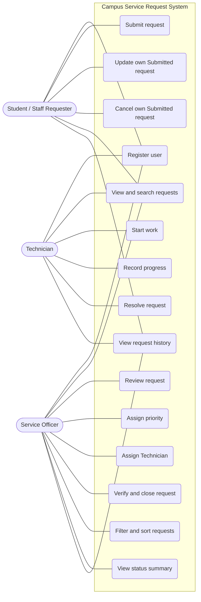
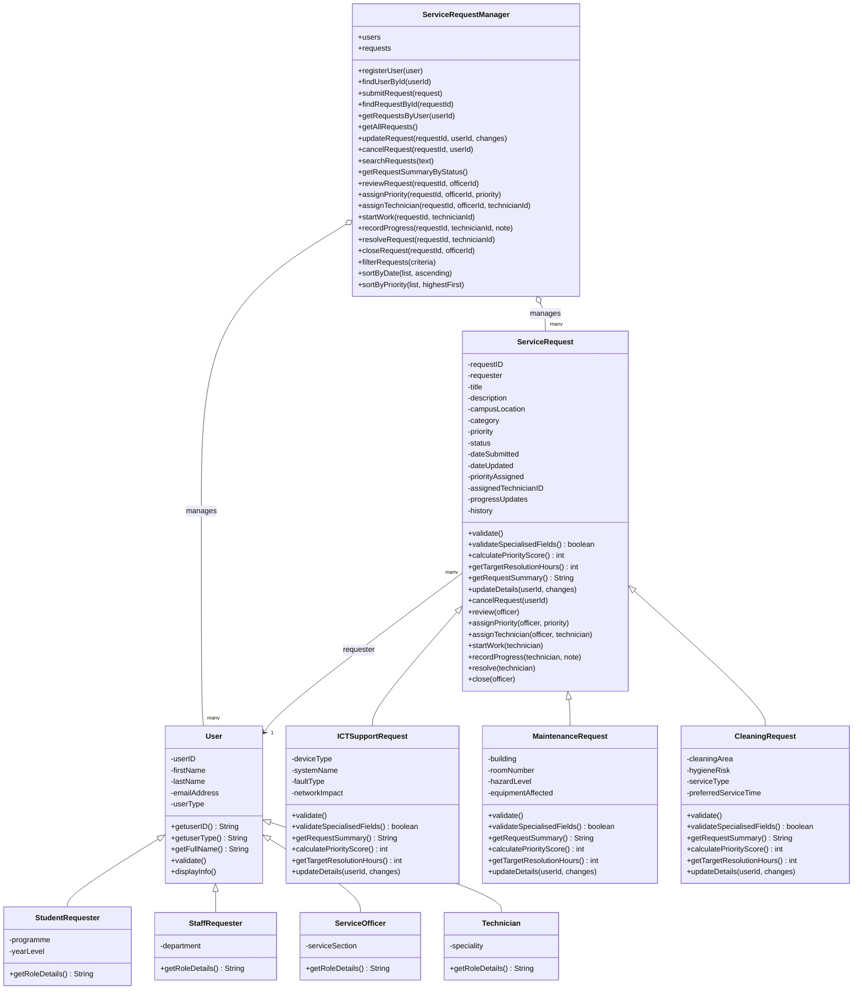
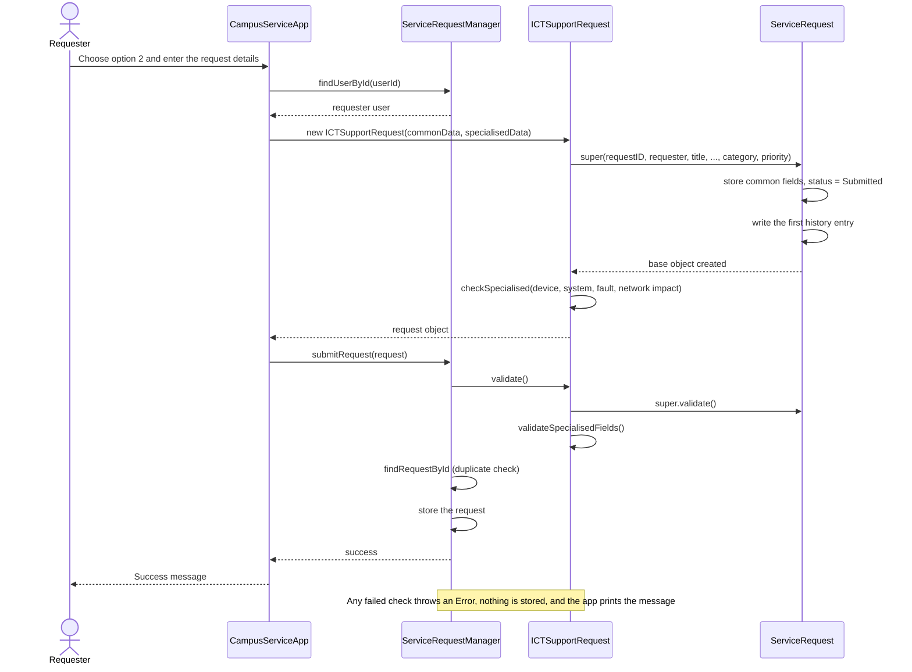

# Project Title: Campus Service Request Management System.

## PROJECT OVERVIEW
The project Campus Service Request Management System, is a JavaScript console-based application build upon the foundation of the unit IS305 Object Orientated Programming (OOP). This project aims to help students and staff of Divine Word University, in terms of reporting several campus-related issues; ICT Services, Facilitites Maintenance, Cleaning and Sanitation and General Campus Service. All these are requested via a prototype terminal, which users - Staff & Students can have access to.

## PROBLEM STATEMENT
### Current context
At Divine Word University, students and staff encounter daily operational issues ranging from network downtime, sanitation needs, broken equipment, transport service(General Campus Service) and so forth.

### Core problem
The current process handles requests manually across all different catoegories. These services are requested via telephone calls, emails, verbal communication and hand-written. Because all these are communicated through infomral channels:
*requests are lost, forgotten or destroyed
*important details (location, issue category) are ommited or left out
*requesters have no clear way to track their requests

### Proposed solution
The proposed solution is a centralized console-based Node.js application built using Object-Oriented Programming (OOP) principles. The project will digitize request submissions, automates request tracking, status workflow and persists service records using local JSON files - providing a transparent and traceable workflow from submission to resolution.

## OBJECTIVES
### General Objective
To design and develop an object-oriented, console-based Campus Service Request Management System in JavaScript (Node.js) that centralizes, tracks, and manages the lifecycle of campus service requests.

### Specific Objectives
Core Application Setup (Pass Milestone): Implement core classes (User, ServiceRequest, ServiceRequestManager) to handle user registration, input validation, request creation, and cancellation using JavaScript arrays and console menus.

Specialized Classes & Role Workflows (Credit Milestone): Apply class inheritance and constructor chaining to create specialized request categories and role-specific interfaces (Requester, Service Officer, Technician, System Administrator).

Data Persistence & Reporting (Distinction Milestone): Utilize polymorphism, abstraction, and Node.js file system modules (fs/promises) to save and restore application state via JSON files and generate management audit reports.

Documentation & Version Control: Maintain sustained version control tracking via GitHub and document system design and setup in README.md.

## SCOPE
### 1. Core Application & Base Features (Pass Level)

+ User & Request Modelling
Object-oriented User and base ServiceRequest classes with data encapsulation and input validation.

+ In-Memory Management
ServiceRequestManager class to store, manage and query requests in an array collection.

+ Interactive Terminal CLI
A terminal-based menu loop allowing users to create, search, update and cancel requests.

### 2. Domain Hierarchy & Role Workflows (Credit Level)

+ Inheritance & Subclasses
Concrete specialized classes (ICTSupportRequest, MaintenanceRequest, CleaningRequest...etc) extending the base request class.

+ Role-Based Access Control (RBAC)
Permission checks for Student/Staff (Requesters), Technicians and Admins.

+ Workflow Management
Controlled status state transitions, technician assignement workflows and history tracking.

### 3. Advanced Architecture, Persistence & Testing (Distinction level)

+ Abstraction & Polymorphism
Abstract-style base class forcusing subclasses to override methods (calculatePriorityScore(), getTargetResolutionHours(), getRequestSummary() ).

+ JSON File Repositories
Asynchronous file persistence using Nodejs fs/promises across 4 JSON storage files (uers.json, serviceRequests.json, requestHistory.json, auditing.json) separated via Repository pattern classes.

+ Object Hydration
ServiceRequestFactory to reconnect fully typed, active object instances from loaded plain JSON data.

+ Auditing & Reporting
Automated event logging engine and a management reporting module delivering key metrics via JavaScript array methods (filter, map, reudce, sort)

+ Automated Testing
Test suit (>=10 tests) using native Node.js test runner for constructor validation, permission, polymorphism, file storage and reporting logic.

## ❌ OUT OF SCOPE

+ External Database
SQL (MySQL, PostgreSQL, SQLite) or NoSQL (MongoDB/Mongoose) databases.

+ Graphical User Interface
Web frontends (HTML/CSS, React) or desktop GUI frameworks.

+ Third-Party Libraries
External ORMs or third-party testing libraries.

## PASS EXTENSION (Core Service Request System)
### Actors and User Roles
Requester (Student / Staff): Registers a user account, submits service requests under allowed categories and priority levels, searches records, updates personal requests, and cancels active submissions.

### Functional Requirement
* User account registration with validation for unique user IDs and correct data formats.

* Service request creation linked to a registered user, specifying a category (ICT Support, Facilities Maintenance, Cleaning and Sanitation, General Campus Service) and priority level (Low, Normal, High, Urgent).

* Querying requests by unique ID, filtering by user ID, or listing all system requests.

* Updating and canceling active requests with proper ownership verification.

### Non-Functional Requirement
Reliability: Comprehensive try...catch error handling to catch invalid inputs and prevent application crashes.

Maintainability: Modular separation of concerns across dedicated class files (User.js, ServiceRequest.js, ServiceRequestManager.js, and CampusServiceApp.js).

### Assumptions and Limitations
* Runs locally within a Node.js terminal environment.

* Data persistence is handled in-memory using JavaScript arrays during runtime.

### User Stories
1. As a student, I want to register an account with my user details so I can submit tickets.

2. As a staff member, I want to submit a service request specifying a category and priority so the issue can be logged.

3. As a requester, I want to view a specific request by its ID to check its details.

4. As a requester, I want to view all requests I have submitted so I can track my active tickets.

5. As a user, I want to view all requests currently recorded in the system.

6. As a requester, I want to update my request details if information changes.

7. As a requester, I want to cancel my request if the issue is resolved.

8. As a user, I want clear error messages if I enter invalid data or attempt unauthorized actions.

### UML System Design
Class Relationships:
* ServiceRequestManager manages a collection (array) of User objects and ServiceRequest objects via      composition/aggregation.
* ServiceRequest holds an association reference to the User instance acting as the requester.

### Technical Documentation

#### Folder structure
AT3_CampusServiceRequestSystem/
├── src/
│   ├── CampusServiceApp.js        # Main terminal CLI menu and controller
│   ├── ServiceRequest.js          # Base request model and validation
│   ├── ServiceRequestManager.js   # In-memory collection manager and query engine
│   └── User.js                    # User model with strict encapsulation
└── README.md                      # Complete project documentation

#### Class responsibilities
User.js: Encapsulates user attributes (userId, firstName, lastName, email, userType).

ServiceRequest.js: Encapsulates ticket details (requestId, requester, title, description, campusLocation, category, priority, status).

ServiceRequestManager.js: Handles array collections, user registration, duplicate checks, search filters, updates, and cancellations.

CampusServiceApp.js: Runs the interactive Node.js readline terminal menu.

Encapsulation: Private properties (prefixed with #) are protected from direct external modification and accessed strictly through getters and validating setters.

Validation & Error Handling: Invalid data entries or unauthorized updates throw standard Error instances that are safely caught in try...catch blocks within the CLI.

### User Guide
Installation Requirements: Ensure Node.js is installed on your system.

Setup Instructions: Open the AT3_CampusServiceRequestSystem folder in VS Code.

Starting the application:
node src/CampusServiceApp.js

Console Navigation: Use numbers 1 through 10 from the main menu to register users, submit requests, view records, update details, or cancel tickets.

### Test Report (Pass Level)
Test 1 – Valid User Registration
Field	Details
Test ID:	T1
Purpose:	To confirm that a user with valid details can be registered in the system.
Menu Option:	1. Register User
Expected Result:	The user is added successfully.
Actual Result:	The system displayed “Success: User registered successfully.”
Status:	Pass
```
============================================
     CAMPUS SERVICE REQUEST SYSTEM
============================================
1. Register User
2. Submit Service Request
3. View Request by ID
4. View My Requests
5. View All Requests
6. Update My Request
7. Cancel My Request
8. Search Requests
9. View Request Summary
10. Exit
============================================
Select an option (1-10): 1
Enter User ID: 240156
Enter First Name: Mary
Enter Last Name: Kala
Enter Email Address: maryk@gmail.com
Enter User Type (e.g. Student/Staff): Student

Success: User registered successfully.
```
Test 2 - Duplicate User ID
Field	Details
Test ID:	T2
Feature tested: Duplicate user ID
Test input:	Register User with ID 240156 (Mary Kala, maryk@gmail.com, Student), after 240156 was already registered
Expected result:	Second user is rejected.
Actual result	Error: Duplicate user ID: User with ID '240156' already exists.
Status:	Pass
Evidence:	duplicate.png (re-take after the fix)
```
============================================
     CAMPUS SERVICE REQUEST SYSTEM
============================================
1. Register User
2. Submit Service Request
3. View Request by ID
4. View My Requests
5. View All Requests
6. Update My Request
7. Cancel My Request
8. Search Requests
9. View Request Summary
10. Exit
============================================
Select an option (1-10): 1
Enter User ID: 240156
Enter First Name: Mary
Enter Last Name: Kala
Enter Email Address: maryk@gmail.com
Enter User Type (e.g. Student/Staff): Student

Error: Duplicate user ID: User with ID 'undefined' already exists.

```

Test 3: Valid Request Submission
Field	Details
Test ID	T3 (Attempt 1)
Feature tested:	Valid request submission
Test input:	User 240156; Request ID Req-001; Title: Electrical; Description: Room study lights need fixing.; Location: Girls dormitory.; Category: 2; Priority: Moderate
Expected result:	Request is stored with Submitted status.
Actual result	Error: Unsupported category: 2
Status:	Fail
Cause and fix:	The numbered category menu passed "2" through as text. CampusServiceApp.js now converts the number to the category name. The priority Moderate was also invalid, because only Low, Normal, High and Urgent are allowed.

Test 3 - 2nd Attempt
```
============================================
     CAMPUS SERVICE REQUEST SYSTEM
============================================
1. Register User
2. Submit Service Request
3. View Request by ID
4. View My Requests
5. View All Requests
6. Update My Request
7. Cancel My Request
8. Search Requests
9. View Request Summary
10. Exit
============================================
Select an option (1-10): 2
Enter Requester User ID: 240156
Enter Request ID: Req-001
Enter Title: Broken study lights
Enter Description: Study lights at the dormitory is broken.
Enter Campus Location: Girls Dormitory
Allowed Categories: 1. ICT Support | 2. Facilities Maintenance | 3. Cleaning and Sanitation | 4. General Campus Service
Enter Category: 2
Allowed Priorities: Low, Normal, High, Urgent
Enter Priority: Normal

Success: Service request submitted successfully with 'Submitted' status.
```

Test 4 - Invalid Request Category
```
============================================
     CAMPUS SERVICE REQUEST SYSTEM
============================================
1. Register User
2. Submit Service Request
3. View Request by ID
4. View My Requests
5. View All Requests
6. Update My Request
7. Cancel My Request
8. Search Requests
9. View Request Summary
10. Exit
============================================
Select an option (1-10): 2
Enter Requester User ID: 240156
Enter Request ID: Req-001
Enter Title: Broken lights
Enter Description: Study lights at the dormitory is not working.
Enter Campus Location: Girls Dormitory
Allowed Categories: 1. ICT Support | 2. Facilities Maintenance | 3. Cleaning and Sanitation | 4. General Campus Service
Enter Category: 2
Allowed Priorities: Low, Normal, High, Urgent
Enter Priority: Moderate

Error: Unsupported priority value: Moderate
```
Test 5 - View Requester Records
```
============================================
     CAMPUS SERVICE REQUEST SYSTEM
============================================
1. Register User
2. Submit Service Request
3. View Request by ID
4. View My Requests
5. View All Requests
6. Update My Request
7. Cancel My Request
8. Search Requests
9. View Request Summary
10. Exit
============================================
Select an option (1-10): 4
Enter User ID to view requests for: 240156

--- Requests for User: 240156 ---
[ID: Req-001] Title: Broken study lights | Category: Facilities Maintenance | Priority: Normal | Status: Submitted | Requester: Mary Kala
```
```
============================================
     CAMPUS SERVICE REQUEST SYSTEM
============================================
1. Register User
2. Submit Service Request
3. View Request by ID
4. View My Requests
5. View All Requests
6. Update My Request
7. Cancel My Request
8. Search Requests
9. View Request Summary
10. Exit
============================================
Select an option (1-10): 4
Enter User ID to view requests for: 240157

--- Requests for User: 240157 ---
[ID: Req-002] Title: Wifi Down | Category: ICT Support | Priority: High | Status: Submitted | Requester: Tessa Paul
```

Test 6 - Cancel Request.
```
============================================
     CAMPUS SERVICE REQUEST SYSTEM
============================================
1. Register User
2. Submit Service Request
3. View Request by ID
4. View My Requests
5. View All Requests
6. Update My Request
7. Cancel My Request
8. Search Requests
9. View Request Summary
10. Exit
============================================
Select an option (1-10): 3
Enter Request ID to view: Req-001

[ID: Req-001] Title: Broken study lights | Category: Facilities Maintenance | Priority: Normal | Status: Submitted | Requester: Mary Kala
Description: Study lights at the dormitory is broken.
Location: Girls Dormitory
Submitted: Mon Oct 19 2026 11:22:35 GMT+1000 (Papua New Guinea Time) | Updated: Mon Oct 19 2026 11:22:35 GMT+1000 (Papua New Guinea Time)

============================================
     CAMPUS SERVICE REQUEST SYSTEM
============================================
1. Register User
2. Submit Service Request
3. View Request by ID
4. View My Requests
5. View All Requests
6. Update My Request
7. Cancel My Request
8. Search Requests
9. View Request Summary
10. Exit
============================================
Select an option (1-10): 7
Enter Request ID to cancel: Req-001
Enter Your User ID (Owner verification): 240156

Success: Request has been cancelled.
```

## CREDIT EXTENSION
## CREDIT EXTENSION (Specialised Requests and Role Workflows)

The Credit extension builds on the Pass system. It adds user and request inheritance, constructor chaining, specialised request types, a controlled status workflow with role permissions, search, filter and sort, and a request history.

---

# 1. Actors and User Roles

The system has four actors. Each is a registered user, and each role is a subclass of the `User` base class.

| Actor | Class | User type value | Specialised fields | Responsibility |
|---|---|---|---|---|
| Student Requester | `StudentRequester` | `Student` | Programme, year level | Submits service requests and manages their own requests |
| Staff Requester | `StaffRequester` | `Staff` | Department | Submits service requests and manages their own requests |
| Service Officer | `ServiceOfficer` | `Service Officer` | Service section | Reviews requests, assigns priority, assigns a Technician, and verifies and closes resolved requests |
| Technician | `Technician` | `Technician` | Technical speciality | Carries out the assigned work: starts it, records progress and resolves it |

**Role permissions**

| Action | Menu option | Student / Staff Requester | Service Officer | Technician |
|---|---|---|---|---|
| Register a user | 1 | Yes | Yes | Yes |
| Submit a service request | 2 | Yes | – | – |
| Update a request | 6 | Own request, while Submitted | – | – |
| Cancel a request | 7 | Own request, while Submitted | – | – |
| Review a request | 10 | – | Yes | – |
| Assign a priority | 11 | – | Yes | – |
| Assign a Technician | 12 | – | Yes | – |
| Start work | 13 | – | – | Only if assigned to the request |
| Record progress | 14 | – | – | Only if assigned to the request |
| Resolve a request | 15 | – | – | Only if assigned to the request |
| Close a request | 16 | – | Yes (Resolved requests only) | – |
| View, search, filter, sort and view history | 3, 4, 5, 8, 9, 17, 18, 19 | Yes | Yes | Yes |

**Notes**
- The system has no login. A user identifies themselves by entering their user ID, and the system checks that ID against the user's registered role.
- A requester can update or cancel a request only if their ID matches the requester stored on that request, and only while its status is Submitted.
- A Technician can work only on requests assigned to them by a Service Officer.
- Requests are intended to be submitted by Student and Staff users. The system does not currently stop a Service Officer or Technician from submitting one.

---

# 2. Functional Requirements

| ID | Requirement |
|---|---|
| FR1 | The system shall provide `User` as a base class, with `StudentRequester`, `StaffRequester`, `ServiceOfficer` and `Technician` as subclasses. Every subclass shall call the `User` constructor using `super()`. |
| FR2 | The system shall provide `ServiceRequest` as a base class, with `ICTSupportRequest`, `MaintenanceRequest` and `CleaningRequest` as subclasses. Every subclass shall call the `ServiceRequest` constructor using `super()`. |
| FR3 | Each specialised request shall validate its own fields: ICT (device type, system name, fault type, network impact), Maintenance (building, room number, hazard level, equipment affected), Cleaning (cleaning area, hygiene risk, service type, preferred service time). |
| FR4 | The system shall enforce the status flow Submitted → Reviewed → Assigned → In Progress → Resolved → Closed. Cancelled is a final status. Invalid transitions shall be rejected. |
| FR5 | A requester may update only their own Submitted request. |
| FR6 | A requester may cancel only their own Submitted request. |
| FR7 | Only a Service Officer may review a request. |
| FR8 | Only a Service Officer may assign a priority, and a priority must be assigned before a Technician can be assigned. |
| FR9 | Only a Service Officer may assign a Technician, and the assignee must be a Technician. |
| FR10 | Only the assigned Technician may start work, record progress or resolve the request. |
| FR11 | Only a Service Officer may close a Resolved request. |
| FR12 | At least two methods shall be overridden in the specialised request classes. |
| FR13 | The system shall search requests by request ID or title. |
| FR14 | The system shall filter requests by category, status, priority and assigned Technician. |
| FR15 | The system shall sort requests by date submitted and by priority. |
| FR16 | Every request shall keep a history of each approved action with previous status, new status, action, actor ID and role, comment, and date and time. |
| FR17 | The system shall show the number of requests in each status. |
| FR18 | The Pass functions (register users, submit, view, update, cancel, search and summary) shall continue to work. |

---

# 3. Non-Functional Requirements

| ID | Requirement |
|---|---|
| NFR1 | **Encapsulation:** class data is held in private fields (`#`) and changed only through getters, validated setters and methods. |
| NFR2 | **Data integrity:** invalid input or an unauthorised action is rejected with a clear message. A rejected update changes nothing. |
| NFR3 | **Maintainability:** each class has one responsibility, and the permitted status transitions are held in a single table (`ServiceRequest.TRANSITIONS`). |
| NFR4 | **Auditability:** every approved status change or workflow action is written to the request history. Rejected actions are not recorded. |
| NFR5 | **Usability:** the console menu is numbered, prompts show the allowed values, and error messages say what went wrong. |
| NFR6 | **Testability:** all Credit behaviour can be checked by an automated test file without using the menu. |
| NFR7 | **Portability:** the application runs on Node.js 14.6 or later with no extra packages. |
| NFR8 | **Compatibility:** the Credit extension keeps the Pass method names and menu options 1 to 9. |

---

# 4. Assumptions and Limitations

**Assumptions**
- Users are registered before they submit or process requests, and user IDs and request IDs are unique.
- Student and Staff users submit requests.
- Service Officers and Technicians are registered through the same Register User option as other users.
- The requester enters a starting priority. The Service Officer then assigns the official priority during review.
- A request is handled by one Technician.
- Request IDs and user IDs must be entered exactly as registered. Leading and trailing spaces are ignored.

**Limitations**
- Data is held in memory and is lost when the application closes. The `data` folder is reserved for later storage, but JSON storage is not implemented at the Credit level.
- There is no login or password. Identity is the user ID entered.
- The system does not stop a Service Officer or Technician from submitting a request.
- Technician reassignment is not supported.
- Closed and Cancelled requests cannot be reopened.
- The category of a specialised request cannot be changed after it is submitted.
- Search covers request ID and title only.
- The console application does not remember who is "logged in", so the user ID is asked for each action.

---

# 5. User Stories

| ID | User story |
|---|---|
| US1 | As a **student**, I want to submit an ICT support request with device and fault details so that the right team can fix my problem. |
| US2 | As a **staff member**, I want to report a maintenance hazard with the building, room and equipment so that it is handled safely. |
| US3 | As a **requester**, I want to report a cleaning problem with the area and hygiene risk so that it is cleaned in time. |
| US4 | As a **requester**, I want to update my request while it is still Submitted so that I can correct mistakes. |
| US5 | As a **requester**, I want to cancel my own Submitted request so that no work is done if I no longer need it. |
| US6 | As a **Service Officer**, I want to review a request and assign its priority so that urgent problems are handled first. |
| US7 | As a **Service Officer**, I want to assign a Technician so that the work has a clear owner. |
| US8 | As a **Technician**, I want to start work and record progress updates so that everyone can see how the job is going. |
| US9 | As a **Technician**, I want to mark my assigned request as resolved so that it can be verified. |
| US10 | As a **Service Officer**, I want to verify and close a Resolved request so that finished work is formally completed. |
| US11 | As a **Service Officer**, I want to search, filter and sort requests so that I can find and prioritise work quickly. |
| US12 | As a **manager**, I want a full history of every request so that I can see who did what and when. |

---

# 6. UML System Design

The diagrams are written in Mermaid and render on GitHub and in most Markdown viewers. Export them as images if your submission needs picture files.

## 6.1 Use Case Diagram



## 6.2 Class Diagram



## 6.3 Sequence Diagram: Submitting a Request



## 6.4 Sequence Diagram: Assigning a Technician

```mermaid
sequenceDiagram
    actor Off as Service Officer
    participant App as CampusServiceApp
    participant Mgr as ServiceRequestManager
    participant Req as ServiceRequest

    Off->>App: Option 10 (Review Request)
    App->>Mgr: reviewRequest(requestId, officerId, comment)
    Mgr->>Req: review(officer, comment)
    Req->>Req: role must be Service Officer
    Req->>Req: transition Submitted to Reviewed, log "Reviewed"
    Off->>App: Option 11 (Assign Priority)
    App->>Mgr: assignPriority(requestId, officerId, priority)
    Mgr->>Req: assignPriority(officer, priority)
    Req->>Req: status must be Reviewed and priority valid
    Req->>Req: priorityAssigned = true, log "Priority assigned"
    Off->>App: Option 12 (Assign Technician)
    App->>Mgr: assignTechnician(requestId, officerId, technicianId)
    Mgr->>Mgr: find the officer and the technician
    Mgr->>Req: assignTechnician(officer, technician)
    alt actor is not a Service Officer
        Req-->>Mgr: Error: Only a Service Officer can assign a Technician
    else assignee is not a Technician or no priority assigned
        Req-->>Mgr: Error
    else valid
        Req->>Req: transition Reviewed to Assigned, log "Technician assigned"
        Req->>Req: store assignedTechnicianID
        Req-->>Mgr: success
    end
    Mgr-->>App: success or error
    App-->>Off: Message
```

## 6.5 Sequence Diagram: Resolving and Closing a Request

```mermaid
sequenceDiagram
    actor Tec as Technician
    actor Off as Service Officer
    participant App as CampusServiceApp
    participant Mgr as ServiceRequestManager
    participant Req as ServiceRequest

    Tec->>App: Option 13 (Start Work)
    App->>Mgr: startWork(requestId, technicianId)
    Mgr->>Req: startWork(technician)
    Req->>Req: must be the assigned Technician
    Req->>Req: transition Assigned to In Progress, log
    Tec->>App: Option 14 (Record Progress)
    App->>Mgr: recordProgress(requestId, technicianId, note)
    Mgr->>Req: recordProgress(technician, note)
    Req->>Req: status must be In Progress, store note, log "Progress update"
    Tec->>App: Option 15 (Resolve Request)
    App->>Mgr: resolveRequest(requestId, technicianId)
    Mgr->>Req: resolve(technician)
    Req->>Req: transition In Progress to Resolved, log "Resolved"
    Off->>App: Option 16 (Close Request)
    App->>Mgr: closeRequest(requestId, officerId)
    Mgr->>Req: close(officer)
    alt actor is not a Service Officer or status is not Resolved
        Req-->>Mgr: Error
    else valid
        Req->>Req: transition Resolved to Closed, log "Closed"
    end
    Mgr-->>App: success or error
    App-->>Off: Message
```

## 6.6 Explanation of Class Relationships

- **Inheritance (is-a):** `StudentRequester`, `StaffRequester`, `ServiceOfficer` and `Technician` each extend `User`, so they share ID, name, email and type handling and add their own role-specific field. `ICTSupportRequest`, `MaintenanceRequest` and `CleaningRequest` each extend `ServiceRequest`, so they share the status, workflow and history logic and add their own specialised fields.
- **Association:** every `ServiceRequest` holds a reference to its requester, which is a `User` (a student or staff member). One user can have many requests, and each request has exactly one requester.
- **Aggregation:** `ServiceRequestManager` holds arrays of users and requests. It looks objects up and passes workflow actions to them, but the rules themselves live in the request classes.
- **Technician link:** a request stores the assigned Technician's ID (not the object), which keeps the request independent of the Technician class.
- **Dependency:** `CampusServiceApp` depends on the manager and on the request and user classes' public methods. It never touches private fields.

---

# 7. Technical Documentation

## 7.1 Encapsulation

- All class data is held in private `#` fields, for example `#status`, `#history` and `#assignedTechnicianID` in `ServiceRequest`, and `#deviceType` in `ICTSupportRequest`. Other code cannot read or change them directly.
- Public **getters** expose the data. `history` and `progressUpdates` return copies, so outside code cannot change the audit trail.
- **Setters are controlled.** `title`, `description`, `category` and `priority` in `ServiceRequest` check the new value before accepting it. There is no setter for `status`, so it can change only through the workflow methods.
- **Private methods** (`#transition`, `#log`, `#requireRole`, `#requireAssignedTechnician`) hold the internal rules and cannot be called from outside the class.
- `getAllRequests()` returns a copy of the request array, so callers cannot change the manager's list.

## 7.2 Inheritance and Constructor Chaining

- `StudentRequester`, `StaffRequester`, `ServiceOfficer` and `Technician` extend `User`.
- `ICTSupportRequest`, `MaintenanceRequest` and `CleaningRequest` extend `ServiceRequest`.
- Every subclass constructor calls its parent constructor first with `super()`:

```javascript
// SpecialisedUsers.js
class Technician extends User {
    constructor(userID, firstName, lastName, emailAddress, speciality) {
        super(userID, firstName, lastName, emailAddress, 'Technician');   // constructor chaining
        ...
    }
}

// SpecialisedRequests.js
class ICTSupportRequest extends ServiceRequest {
    constructor(commonRequestData, specialisedData = {}) {
        const c = commonRequestData;
        super(c.requestID, c.requester, c.title, c.description,
              c.campusLocation, 'ICT Support', c.priority);               // constructor chaining
        ICTSupportRequest.checkSpecialised(specialisedData);              // then validate the specialised fields
        ...
    }
}
```

The parent constructor sets the common data first, and the subclass then validates and stores its own fields. The subclass fixes the user type and the category, so they cannot be entered wrongly. `commonRequestData` is one object, and the subclass unpacks it into the base constructor's arguments.

## 7.3 Overriding and Polymorphism

**Method overriding**

| Method | Base version (`ServiceRequest`) | Specialised version |
|---|---|---|
| `getRequestSummary()` | Common summary line | Each subclass calls `super.getRequestSummary()` and adds its own fields |
| `calculatePriorityScore()` | Priority position (Low = 1 to Urgent = 4) | ICT adds 2 per network-impact level, Maintenance adds 3 per hazard level, Cleaning adds 2 per hygiene-risk level |
| `getTargetResolutionHours()` | 72 hours | ICT: 72 / 48 / 24 / 4 by impact. Maintenance: 120 / 48 / 8 by hazard. Cleaning: 48 / 24 / 6 by hygiene risk |
| `validateSpecialisedFields()` | Returns `true` | Each subclass checks its own fields |
| `validate()` | Checks the common fields | Each subclass calls `super.validate()` and then `validateSpecialisedFields()` |
| `updateDetails()` | Updates common fields | Each subclass also updates its own fields, validating before changing anything |

**Polymorphism.** The manager stores every request as a `ServiceRequest`. It calls `validate()`, `getRequestSummary()`, `calculatePriorityScore()` or `getTargetResolutionHours()` without knowing the request's type, and each object runs its own version:

```javascript
for (const request of manager.getAllRequests()) {
    console.log(request.getRequestSummary());   // ICT, Maintenance, Cleaning or General details appear automatically
}
```

## 7.4 How the Request Workflow Is Controlled

- The permitted flow is held in one table, `ServiceRequest.TRANSITIONS`:

| From | Allowed next status |
|---|---|
| Submitted | Reviewed, Cancelled |
| Reviewed | Assigned |
| Assigned | In Progress |
| In Progress | Resolved |
| Resolved | Closed |
| Closed | none (final) |
| Cancelled | none (final) |

- Every status change goes through one private method, `#transition()`. It rejects any move that is not in the table with `Invalid status transition: X -> Y`, and otherwise updates the status and writes the history entry.
- Role rules are checked before the transition:
  - Requesters: only the owner, and only while the request is Submitted, may update or cancel.
  - Only a Service Officer may review, assign a priority, assign a Technician or close.
  - Only the assigned Technician may start, record progress or resolve.
- A priority must be assigned by the Service Officer (while the request is Reviewed) before a Technician can be assigned.
- Because status has no setter and `#transition()` is private, the workflow cannot be bypassed.

## 7.5 How Validation and Errors Are Handled

- Validation uses `validate()` on users and requests and a static `checkSpecialised()` method in each specialised request. They throw an `Error` with a clear message when data is missing or unsupported.
- Updates are **validated before they are applied**, so a failed update changes nothing.
- Specialised constructors validate their own fields, so an invalid specialised request cannot be created.
- The manager adds system-level checks: duplicate user IDs, duplicate request IDs, unknown users and requests.
- Permission and workflow failures are also thrown as `Error`s.
- `CampusServiceApp.js` wraps each action in `try/catch` and prints `Error: <message>`, so the program keeps running after a mistake.
- Rejected actions are not written to the request history.

## 7.6 How JSON Data Is Stored and Restored

JSON file storage is **not part of the Credit level**. Users and requests are kept in memory arrays inside `ServiceRequestManager` and are lost when the application closes. The `data` folder is already in the project and is reserved for stored data in a later level.

## 7.7 How Tests Are Organised

All automated tests are in `src/CreditTests.js` and run with `node src/CreditTests.js`.

- A small `test(name, fn)` helper runs each test, prints `PASS` or `FAIL`, and sets a failing exit code if anything fails.
- A `setup()` function builds a fresh manager with a student, a staff member, a Service Officer and two Technicians for each test, so tests do not affect each other.
- Tests use Node's built-in `assert` module, so no packages are needed.
- There are 16 tests: 7 Pass tests (to confirm nothing broke), the 8 required Credit tests, and 1 extra check that only Service Officers can review and that a priority is needed before assignment.

## 7.8 Known Limitations and Future Improvements

**Known limitations**
- In-memory storage only, with no JSON file storage.
- No login or password.
- One Technician per request, with no reassignment.
- Closed and Cancelled requests cannot be reopened.
- Search covers request ID and title only.
- The manager's `users` and `requests` arrays are ordinary properties and are not private.
- A Service Officer or Technician can submit a request.

**Future improvements**
- Save and restore users and requests as JSON files in the `data` folder.
- Add login with password checking.
- Block non-requesters from submitting requests.
- Allow reassignment and reopening, with history entries.
- Add reports (by category, Technician workload, average resolution time) and overdue warnings using `getTargetResolutionHours()`.
- Make the manager's arrays private.

---

# 8. Folder Structure

```
AT3_CampusServiceRequestSystem/
├── data/                           Reserved for stored data (not used at Credit level)
├── src/
│   ├── User.js                     Base user class
│   ├── SpecialisedUsers.js         StudentRequester, StaffRequester, ServiceOfficer, Technician
│   ├── ServiceRequest.js           Base request class, workflow rules, role checks, history
│   ├── SpecialisedRequests.js      ICTSupportRequest, MaintenanceRequest, CleaningRequest
│   ├── ServiceRequestManager.js    Stores users and requests, search, filter, sort, summary
│   ├── CampusServiceApp.js         Console menu and user interaction
│   └── CreditTests.js              Automated Pass and Credit tests
├── .gitkeep
└── README.md                       This documentation
```

---

# 9. Class Responsibilities

| Class | File | Responsibility |
|---|---|---|
| `User` | `User.js` | Holds and validates common user data (ID, name, email, type). |
| `StudentRequester` | `SpecialisedUsers.js` | A `User` with programme and year level. Submits and manages their own requests. |
| `StaffRequester` | `SpecialisedUsers.js` | A `User` with a department. Submits and manages their own requests. |
| `ServiceOfficer` | `SpecialisedUsers.js` | A `User` with a service section. Reviews, assigns priority and Technician, and closes requests. |
| `Technician` | `SpecialisedUsers.js` | A `User` with a technical speciality. Starts, updates and resolves assigned work. |
| `ServiceRequest` | `ServiceRequest.js` | Holds common request data, controls the status workflow, enforces role permissions and records history. Also handles General Campus Service requests directly. |
| `ICTSupportRequest` | `SpecialisedRequests.js` | Adds device type, system name, fault type and network impact, with its own validation, summary, score and target hours. |
| `MaintenanceRequest` | `SpecialisedRequests.js` | Adds building, room number, hazard level and equipment affected, with its own validation, summary, score and target hours. |
| `CleaningRequest` | `SpecialisedRequests.js` | Adds cleaning area, hygiene risk, service type and preferred service time, with its own validation, summary, score and target hours. |
| `ServiceRequestManager` | `ServiceRequestManager.js` | Registers users, stores requests, finds users and requests, passes workflow actions to the request, and provides search, filter, sort and the status summary. |
| `CampusServiceApp` | `CampusServiceApp.js` | Shows the menu, reads input, calls the manager, and prints results or error messages. |
| Test file | `CreditTests.js` | Runs the automated Pass and Credit tests. |

---

# 10. User Guide

## 10.1 Installation Requirements

- Node.js **14.6 or later** (check with `node --version`).
- A terminal, such as the one in VS Code.
- No extra packages are needed.

## 10.2 Setup Instructions

1. Keep the project files in the folder layout shown in section 8.
2. Open a terminal in the project folder, `AT3_CampusServiceRequestSystem` (in VS Code: Terminal > New Terminal, then `cd AT3_CampusServiceRequestSystem`).
3. Confirm Node.js is installed: `node --version`.

## 10.3 Starting the Application

```
node src/CampusServiceApp.js
```

The menu appears. Options 1 to 9 are the Pass options and 10 to 19 are the Credit options:

```
============================================
     CAMPUS SERVICE REQUEST SYSTEM
============================================
1. Register User
2. Submit Service Request
3. View Request by ID
4. View My Requests
5. View All Requests
6. Update My Request
7. Cancel My Request
8. Search Requests
9. View Request Summary
--------------- Credit ---------------------
10. Review Request (Service Officer)
11. Assign Priority (Service Officer)
12. Assign Technician (Service Officer)
13. Start Work (Technician)
14. Record Progress (Technician)
15. Resolve Request (Technician)
16. Close Request (Service Officer)
17. Filter Requests
18. Sort Requests
19. View Request History
--------------------------------------------
20. Exit
============================================
```

To run the automated tests instead: `node src/CreditTests.js`

Data is kept only while the application is running. Register your users again each time you start it.

## 10.4 Registering or Selecting a User

Choose **1. Register User** and enter the user ID, first name, last name, email and user type. The app then asks for the details of that role:

| User type | Extra details asked |
|---|---|
| Student | Programme, year level (1 to 8) |
| Staff | Department |
| Service Officer | Service section |
| Technician | Technical speciality |

There is no login. Each later action asks for your user ID to identify you.

## 10.5 Submitting a Request

1. Choose **2. Submit Service Request**.
2. Enter your user ID (you must be registered), then a unique request ID, title, description and campus location.
3. Choose a category (1 to 4, or type the name) and a priority (Low, Normal, High or Urgent).
4. For categories 1 to 3, enter the specialised details:

| Category | Details asked |
|---|---|
| 1. ICT Support | Device type, system name, fault type, network impact (None / Single User / Department / Campus-wide) |
| 2. Facilities Maintenance | Building, room number, hazard level (Low / Medium / High), equipment affected |
| 3. Cleaning and Sanitation | Cleaning area, hygiene risk (Low / Medium / High), service type, preferred service time |
| 4. General Campus Service | None |

The request is stored with status **Submitted**. While it is still Submitted, the requester can use **6. Update My Request** (blank answers keep the current value) or **7. Cancel My Request**.

## 10.6 Assigning and Processing a Request

| Step | Menu option | Who | Action | Status after |
|---|---|---|---|---|
| 1 | 10 | Service Officer | Review the request | Reviewed |
| 2 | 11 | Service Officer | Assign a priority | Reviewed |
| 3 | 12 | Service Officer | Assign a Technician | Assigned |
| 4 | 13 | Assigned Technician | Start work | In Progress |
| 5 | 14 | Assigned Technician | Record progress (repeat as needed) | In Progress |
| 6 | 15 | Assigned Technician | Resolve the request | Resolved |
| 7 | 16 | Service Officer | Verify and close the request | Closed |

Each step asks for the acting user's ID and the request ID. A wrong user or a step out of order is rejected with an error message, and the request is not changed.

## 10.7 Searching, Filtering, Sorting and Reports

| Task | Menu option | How |
|---|---|---|
| View one request | 3 | Enter the request ID to see its details, assigned Technician, target hours and priority score. |
| View a user's requests | 4 | Enter the user ID. |
| View all requests | 5 | Lists every request. |
| Search | 8 | Enter part of a request ID or title (case does not matter). |
| Status report | 9 | Shows the number of requests in each status. |
| Filter | 17 | Answer the four questions: category, status, priority and Technician ID. Leave a question blank to skip it. Filters can be combined. |
| Sort | 18 | Choose 1 to 4: date oldest first, date newest first, priority highest first, priority lowest first. |
| Request history | 19 | Enter the request ID to see every approved action with the actor, comment and time. |

## 10.8 Example Console Screenshots

Add your own screenshots for each item and save them in a `screenshots` folder:

| Screenshot | Suggested file |
|---|---|
| Registering each type of user | `register_users.png` |
| Submitting a specialised request | `submit_request.png` |
| Specialised field rejected | `specialised_rejected.png` |
| A rejected workflow action | `rejected_action.png` |
| A request taken through to Closed | `closed_request.png` |
| Request history | `request_history.png` |
| Search, filter and sort results | `search_filter_sort.png` |
| Automated test output | `credit_tests.png` |

## 10.9 Common Errors and Solutions

| Error message | Cause | Solution |
|---|---|---|
| `Duplicate user ID: User with ID '...' already exists.` | The user ID is already registered. | Use a different user ID. |
| `Duplicate request ID: Request with ID '...' already exists.` | The request ID is already used. | Use a new request ID. |
| `User ID not found. Please register or provide a valid ID.` | The requester is not registered (or the app was restarted). | Register the user first. |
| `User not found: ...` | A user ID entered in a workflow step is not registered. | Check the ID and register the user if needed. |
| `Request not found.` | The request ID does not exist. | Check the ID (it must be typed exactly as submitted). |
| `Unsupported category: ...` | The category is not one of the four allowed. | Enter 1 to 4 or a valid category name. |
| `Unsupported priority value: ...` | The priority is not Low, Normal, High or Urgent. | Use one of the four values. |
| `Unsupported user type: ...` | The user type is not Student, Staff, Service Officer or Technician. | Use one of the four types. |
| `Year level must be a whole number from 1 to 8.` | The year level is not valid. | Enter a number from 1 to 8. |
| `Network impact must be one of: ...` / `Hazard level must be one of: ...` / `Hygiene risk must be one of: ...` | A specialised field has an unsupported value. | Use one of the listed values. |
| `Device type is required.` (and similar) | A required specialised field was left blank. | Enter a value. |
| `Unauthorized update: Updates attempted by another user.` | Another user tried to update the request. | Use the requester's own user ID. |
| `Unauthorized cancellation: Cancellation of another user's request is not allowed.` | Another user tried to cancel the request. | Use the requester's own user ID. |
| `Request is already marked Cancelled.` | The request was already cancelled. | No action is needed. |
| `Only Submitted requests can be updated (current status: ...).` / `Only Submitted requests can be cancelled (current status: ...).` | The request has already moved past Submitted. | Updates and cancellation are only allowed while Submitted. |
| `The category of a specialised request cannot be changed.` | An update tried to change the category. | Leave the category blank. |
| `Only a Service Officer can review requests.` (and similar for priority, assignment and closing) | The acting user is not a Service Officer. | Use a Service Officer's user ID. |
| `Only the assigned Technician can perform this action.` | Wrong Technician, or not a Technician. | Use the assigned Technician's user ID. |
| `A priority must be assigned before assigning a Technician.` | The officer skipped the priority step. | Run option 11 first. |
| `The assignee must be a Technician.` | The ID given is not a Technician. | Use a Technician's user ID. |
| `Invalid status transition: X -> Y` | The action is out of order. | Follow the workflow order in section 10.6. |
| `Progress can only be recorded while the request is In Progress.` | Work has not started or is already resolved. | Start the work first (option 13). |

## Test Report
Test 1: Sub-class constructors correctly call super().  

Registering Student:
```
============================================
     CAMPUS SERVICE REQUEST SYSTEM
============================================
1. Register User
2. Submit Service Request
3. View Request by ID
4. View My Requests
5. View All Requests
6. Update My Request
7. Cancel My Request
8. Search Requests
9. View Request Summary
--------------- Credit ---------------------
10. Review Request (Service Officer)
11. Assign Priority (Service Officer)
12. Assign Technician (Service Officer)
13. Start Work (Technician)
14. Record Progress (Technician)
15. Resolve Request (Technician)
16. Close Request (Service Officer)
17. Filter Requests
18. Sort Requests
19. View Request History
--------------------------------------------
20. Exit
============================================
Select an option (1-20): 1
Enter User ID: 240156
Enter First Name: Mary
Enter Last Name: Kala
Enter Email Address: maryk@gmail.com
Enter User Type (Student/Staff/Service Officer/Technician): Student
Enter Programme: Information System
Enter Year Level: 3

Success: User registered successfully.
```
Registering staff:
```
============================================
     CAMPUS SERVICE REQUEST SYSTEM
============================================
1. Register User
2. Submit Service Request
3. View Request by ID
4. View My Requests
5. View All Requests
6. Update My Request
7. Cancel My Request
8. Search Requests
9. View Request Summary
--------------- Credit ---------------------
10. Review Request (Service Officer)
11. Assign Priority (Service Officer)
12. Assign Technician (Service Officer)
13. Start Work (Technician)
14. Record Progress (Technician)
15. Resolve Request (Technician)
16. Close Request (Service Officer)
17. Filter Requests
18. Sort Requests
19. View Request History
--------------------------------------------
20. Exit
============================================
Select an option (1-20): 1
Enter User ID: ST1
Enter First Name: Ben 
Enter Last Name: Aru
Enter Email Address: bena@gmail.com
Enter User Type (Student/Staff/Service Officer/Technician): Staff
Enter Department: Commerce

Success: User registered successfully.
```
Registering Service Officer:
```
============================================
     CAMPUS SERVICE REQUEST SYSTEM
============================================
1. Register User
2. Submit Service Request
3. View Request by ID
4. View My Requests
5. View All Requests
6. Update My Request
7. Cancel My Request
8. Search Requests
9. View Request Summary
--------------- Credit ---------------------
10. Review Request (Service Officer)
11. Assign Priority (Service Officer)
12. Assign Technician (Service Officer)
13. Start Work (Technician)
14. Record Progress (Technician)
15. Resolve Request (Technician)
16. Close Request (Service Officer)
17. Filter Requests
18. Sort Requests
19. View Request History
--------------------------------------------
20. Exit
============================================
Select an option (1-20): 1
Enter User ID: 01
Enter First Name: Oli 
Enter Last Name: Toa
Enter Email Address: olit@gmail.com
Enter User Type (Student/Staff/Service Officer/Technician): Service Officer
Enter Service Section: Facilities

Success: User registered successfully.
```
Registering Technician:
```
============================================
     CAMPUS SERVICE REQUEST SYSTEM
============================================
1. Register User
2. Submit Service Request
3. View Request by ID
4. View My Requests
5. View All Requests
6. Update My Request
7. Cancel My Request
8. Search Requests
9. View Request Summary
--------------- Credit ---------------------
10. Review Request (Service Officer)
11. Assign Priority (Service Officer)
12. Assign Technician (Service Officer)
13. Start Work (Technician)
14. Record Progress (Technician)
15. Resolve Request (Technician)
16. Close Request (Service Officer)
17. Filter Requests
18. Sort Requests
19. View Request History
--------------------------------------------
20. Exit
============================================
Select an option (1-20): 1
Enter User ID: T1
Enter First Name: Tim
Enter Last Name: Vai
Enter Email Address: taiv@gmail.com
Enter User Type (Student/Staff/Service Officer/Technician): Technician
Enter Technical Speciality: Networks

Success: User registered successfully.
```

Missing first name error:
```
============================================
     CAMPUS SERVICE REQUEST SYSTEM
============================================
1. Register User
2. Submit Service Request
3. View Request by ID
4. View My Requests
5. View All Requests
6. Update My Request
7. Cancel My Request
8. Search Requests
9. View Request Summary
--------------- Credit ---------------------
10. Review Request (Service Officer)
11. Assign Priority (Service Officer)
12. Assign Technician (Service Officer)
13. Start Work (Technician)
14. Record Progress (Technician)
15. Resolve Request (Technician)
16. Close Request (Service Officer)
17. Filter Requests
18. Sort Requests
19. View Request History
--------------------------------------------
20. Exit
============================================
Select an option (1-20): 1
Enter User ID: 240157
Enter First Name: 
Enter Last Name: Peter
Enter Email Address: kellyp@gmail.com
Enter User Type (Student/Staff/Service Officer/Technician): Student
Enter Programme: IT
Enter Year Level: 2

Error: Missing first name
```
Test 2: Specialised fields are validated
Enter correct hazard level:
```
============================================
     CAMPUS SERVICE REQUEST SYSTEM
============================================
1. Register User
2. Submit Service Request
3. View Request by ID
4. View My Requests
5. View All Requests
6. Update My Request
7. Cancel My Request
8. Search Requests
9. View Request Summary
--------------- Credit ---------------------
10. Review Request (Service Officer)
11. Assign Priority (Service Officer)
12. Assign Technician (Service Officer)
13. Start Work (Technician)
14. Record Progress (Technician)
15. Resolve Request (Technician)
16. Close Request (Service Officer)
17. Filter Requests
18. Sort Requests
19. View Request History
--------------------------------------------
20. Exit
============================================
Select an option (1-20): 2
Enter Requester User ID: 240156
Enter Request ID: Req-001
Enter Title: Broken lights
Enter Description: Need to repair broken lights.
Enter Campus Location: Girls dormitory
Allowed Categories: 1. ICT Support | 2. Facilities Maintenance | 3. Cleaning and Sanitation | 4. General Campus Service
Enter Category: 2
Allowed Priorities: Low, Normal, High, Urgent
Enter Priority: High
Enter Building: A
Enter Room Number: 204
Enter Hazard Level (Low/Medium/High): Extreme
Enter Equipment Affected: Light

Error: Hazard level must be one of: Low, Medium, High
```

Missing field not allowed:
```
============================================
     CAMPUS SERVICE REQUEST SYSTEM
============================================
1. Register User
2. Submit Service Request
3. View Request by ID
4. View My Requests
5. View All Requests
6. Update My Request
7. Cancel My Request
8. Search Requests
9. View Request Summary
--------------- Credit ---------------------
10. Review Request (Service Officer)
11. Assign Priority (Service Officer)
12. Assign Technician (Service Officer)
13. Start Work (Technician)
14. Record Progress (Technician)
15. Resolve Request (Technician)
16. Close Request (Service Officer)
17. Filter Requests
18. Sort Requests
19. View Request History
--------------------------------------------
20. Exit
============================================
Select an option (1-20): 2
Enter Requester User ID: T1
Enter Request ID: Req-003
Enter Title: Garbage pollution
Enter Description: Rubbish outlet is filled.
Enter Campus Location: Admin Block
Allowed Categories: 1. ICT Support | 2. Facilities Maintenance | 3. Cleaning and Sanitation | 4. General Campus Service
Enter Category: 3
Allowed Priorities: Low, Normal, High, Urgent
Enter Priority: High
Enter Cleaning Area: 
Enter Hygiene Risk (Low/Medium/High): High
Enter Service Type: Spot clean
Enter Preferred Service Time: 14:00

Error: Cleaning area is required.
```

Test 3: Only Service Officers can assign Technicians.
Non-Service Officer
```

============================================
     CAMPUS SERVICE REQUEST SYSTEM
============================================
1. Register User
2. Submit Service Request
3. View Request by ID
4. View My Requests
5. View All Requests
6. Update My Request
7. Cancel My Request
8. Search Requests
9. View Request Summary
--------------- Credit ---------------------
10. Review Request (Service Officer)
11. Assign Priority (Service Officer)
12. Assign Technician (Service Officer)
13. Start Work (Technician)
14. Record Progress (Technician)
15. Resolve Request (Technician)
16. Close Request (Service Officer)
17. Filter Requests
18. Sort Requests
19. View Request History
--------------------------------------------
20. Exit
============================================
Select an option (1-20): 10
Enter Service Officer ID: ST1
Enter Request ID: Req-001
Enter comment (optional): 

Error: Only a Service Officer can review requests.
```

Service Officer reviews request:
```
============================================
     CAMPUS SERVICE REQUEST SYSTEM
============================================
1. Register User
2. Submit Service Request
3. View Request by ID
4. View My Requests
5. View All Requests
6. Update My Request
7. Cancel My Request
8. Search Requests
9. View Request Summary
--------------- Credit ---------------------
10. Review Request (Service Officer)
11. Assign Priority (Service Officer)
12. Assign Technician (Service Officer)
13. Start Work (Technician)
14. Record Progress (Technician)
15. Resolve Request (Technician)
16. Close Request (Service Officer)
17. Filter Requests
18. Sort Requests
19. View Request History
--------------------------------------------
20. Exit
============================================
Select an option (1-20): 
Select an option (1-20): 10
Enter Service Officer ID: 01
Enter Request ID: Req-004
Enter comment (optional): 

Success: Request reviewed. Status is now Reviewed.
```

Assigns prioritory:
```
============================================
     CAMPUS SERVICE REQUEST SYSTEM
============================================
1. Register User
2. Submit Service Request
3. View Request by ID
4. View My Requests
5. View All Requests
6. Update My Request
7. Cancel My Request
8. Search Requests
9. View Request Summary
--------------- Credit ---------------------
10. Review Request (Service Officer)
11. Assign Priority (Service Officer)
12. Assign Technician (Service Officer)
13. Start Work (Technician)
14. Record Progress (Technician)
15. Resolve Request (Technician)
16. Close Request (Service Officer)
17. Filter Requests
18. Sort Requests
19. View Request History
--------------------------------------------
20. Exit
============================================
Select an option (1-20): 11
Enter Service Officer ID: 01
Enter Request ID: Req-004
Allowed Priorities: Low, Normal, High, Urgent
Enter Priority: Urgent

Success: Priority assigned.
```

Assigns Technician:
```
============================================
     CAMPUS SERVICE REQUEST SYSTEM
============================================
1. Register User
2. Submit Service Request
3. View Request by ID
4. View My Requests
5. View All Requests
6. Update My Request
7. Cancel My Request
8. Search Requests
9. View Request Summary
--------------- Credit ---------------------
10. Review Request (Service Officer)
11. Assign Priority (Service Officer)
12. Assign Technician (Service Officer)
13. Start Work (Technician)
14. Record Progress (Technician)
15. Resolve Request (Technician)
16. Close Request (Service Officer)
17. Filter Requests
18. Sort Requests
19. View Request History
--------------------------------------------
20. Exit
============================================
Select an option (1-20): 12
Enter Service Officer ID: 01
Enter Request ID: Req-004
Enter Technician ID: T1

Success: Technician assigned. Status is now Assigned.
```
